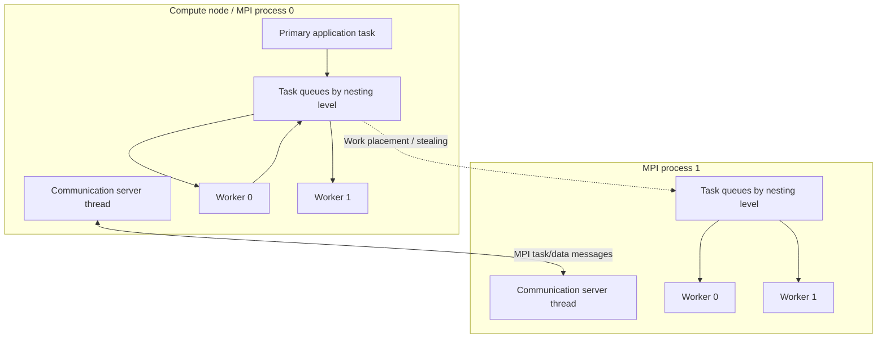
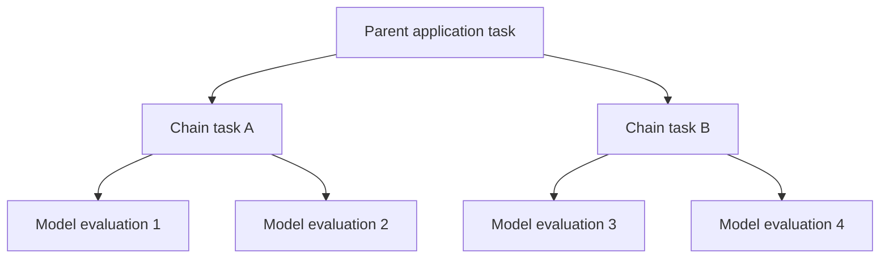
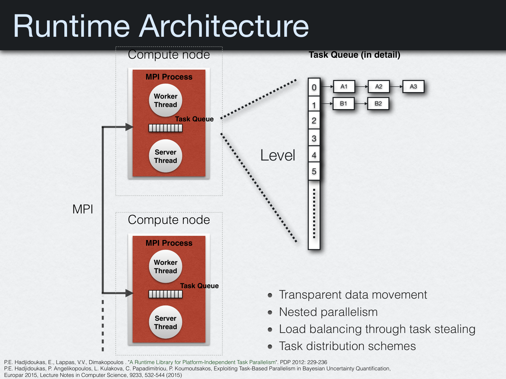

# Runtime architecture

Torc-Lite combines **MPI processes** with **local POSIX worker threads**. The library manages queues of tasks and communicates task descriptors and argument data between MPI processes. An internal server thread handles interprocess communication.

## Components

| Component | Responsibility | Source |
|---|---|---|
| Application-facing task API | Create tasks, manage argument modes, synchronize | [`src/torc.c`](https://github.com/CEID-HPCLAB/torc_lite/blob/master/src/torc.c) |
| Runtime and scheduler | Execute tasks, synchronization, scheduler loop, statistics | [`src/torc_runtime.c`](https://github.com/CEID-HPCLAB/torc_lite/blob/master/src/torc_runtime.c) |
| Queues and placement | Local queues, target workers and remote queue insertion | [`src/torc_queue.c`](https://github.com/CEID-HPCLAB/torc_lite/blob/master/src/torc_queue.c) |
| MPI communication | Task messages, results, broadcasts, registration | [`src/torc_comm.c`](https://github.com/CEID-HPCLAB/torc_lite/blob/master/src/torc_comm.c) |
| Worker threads | Local pthread creation and worker scheduling | [`src/torc_thread.c`](https://github.com/CEID-HPCLAB/torc_lite/blob/master/src/torc_thread.c) |
| Communication server | Receives and serves task messages / requests | [`src/torc_server.c`](https://github.com/CEID-HPCLAB/torc_lite/blob/master/src/torc_server.c) |

## Task hierarchy

A task can create child tasks, and those child tasks can launch more work. A queued task is detached from the worker that created it: the runtime may execute it on another eligible worker or MPI process.

This is the underlying rationale for multilevel parallelism in **TMCMC and other Pi4U algorithms**. The algorithms are outside the runtime: Torc-Lite does not itself implement TMCMC, Bayesian inference, or CMA-ES. See [research applications](../research/applications.md).

## Historical architecture schematic

*Historical illustration from Hadjidoukas, “Exploiting Task-Based Parallelism in Bayesian Uncertainty Quantification,” CEID University of Patras presentation (March 2022), slide 15. It illustrates the general TORC runtime concept; consult the current source for the exact behavior of this Torc-Lite checkout.*

## Distinguishing general TORC publications from Torc-Lite

The [PDP 2012 paper](../research/publications.md) and the [2015 Pi4U paper](../research/publications.md) describe the broader TORC programming model and its use at scale. The API, build requirements, and behavior documented elsewhere on **this site** are grounded in the **current CEID-HPCLAB `torc_lite` source**, including differences introduced in later maintenance work.
