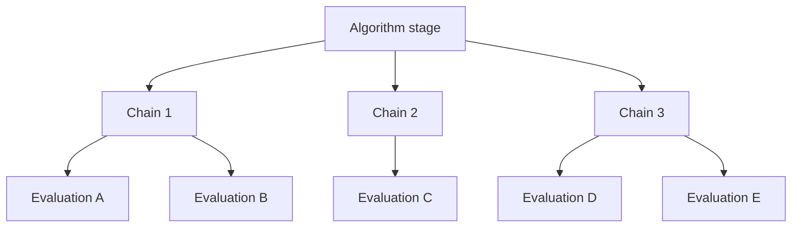

# Scheduling and work stealing

Torc-Lite schedules asynchronous tasks from queues and can redistribute eligible tasks to balance uneven execution times. Application code can decide where tasks are **initially** placed; the runtime can then adapt through task stealing.

## Automatic distribution

```c
torc_create(-1, work, 2, /* argument triples and addresses */);
```

A `queue` argument of `-1` is used by the repository examples to request automatic placement rather than naming one specific worker. The implementation maintains placement state in `src/torc_queue.c`.

For explicitly targeted work, use a **global worker ID** available from `torc_worker_id()` and `torc_num_workers()`, but consider the consequences for load balance and data locality.

## Work stealing

```c
torc_enable_stealing();
/* submit irregular tasks */
torc_waitall();
torc_disable_stealing();
```

A positive `TORC_STEALING` environment value can also enable stealing when the runtime starts. The scheduler attempts local work before obtaining tasks from a remote MPI process. Whether stealing is useful depends on task granularity, data-transfer cost, and task distribution.

## Hierarchical workloads

Suppose a Bayesian inference algorithm has variable-length Markov chains and multiple model evaluations per chain. A useful structure is:



Torc-Lite supports tasks created from tasks. The **algorithm** controls how many tasks it creates and may sort or partition heavy tasks before submission. TORC handles the execution layer. The 2015 [Pi4U paper](../research/publications.md) discusses this separation, including preferential distribution of coarse-grained tasks and use of stealing to reduce idle time.

## Balancing strategy

For irregular workloads, investigate in this order:

1. Estimate task creation/communication overhead and avoid extremely fine-grained remote tasks.
2. Ensure enough tasks exist to occupy workers when some tasks take longer than others.
3. Enable task stealing where it is appropriate.
4. Prefer submitting long predicted tasks earlier if estimates are reliable.
5. Use nested tasks to expose parallelism inside slow top-level tasks, where the algorithm allows it.

The historical [ML-aided scheduling study](../research/scheduling-studies.md) illustrates the fifth and fourth principles, but **there is no general pretrained runtime-prediction API exposed in the current Torc-Lite C header**.

## Measurement

For experiments, record MPI ranks, local workers, problem size, work distribution, task-time variance, total time and communication overhead. Use `torc_gettime()` for elapsed wall-clock measurements inside the runtime, and compare serial execution with single- and multi-rank task runs.
