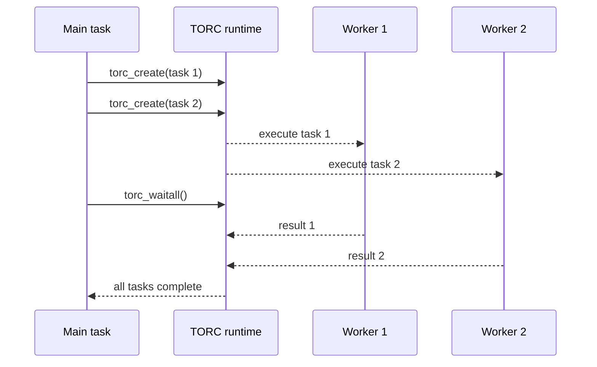

# Master–worker tasks

The **master–worker** pattern is the recommended first example. Source: [`demo/masterslave.c`](../generated/examples/masterslave.md).

1. Define `slave(double *pin, double *out)` to compute a value from one input.
2. Register `slave` so other MPI processes can identify it.
3. Initialize Torc-Lite in master–worker mode.
4. Submit four tasks with `CALL_BY_COP` inputs and `CALL_BY_RES` outputs.
5. Wait for all child tasks, then consume their outputs.



The results are available *after the wait*, not necessarily at the point of submission.

## Run

```bash
TORC_WORKERS=2 mpirun -np 1 ./demo/masterslave
TORC_WORKERS=2 mpirun -np 2 ./demo/masterslave
```

The demo sleeps inside each task, making potential concurrency easy to observe. It calls `torc_enable_stealing()` before measuring task completion.

Read: [the complete source](../generated/examples/masterslave.md), [first program](../getting-started/first-program.md), and [data movement](../concepts/arguments.md).
