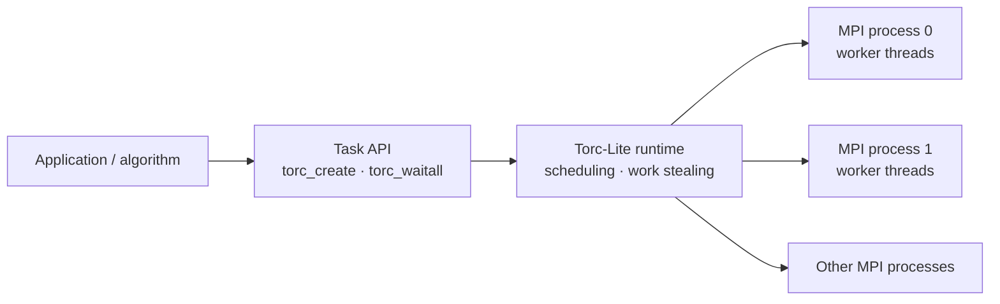

# Torc-Lite

<p class="project-lead">A lightweight, task-based runtime for parallel programs on multicore systems and MPI clusters.</p>

**Torc-Lite** lets C and Fortran applications create asynchronous tasks, synchronize their results, and distribute work using worker threads, MPI processes, and task stealing. Its programming model separates *what a task computes* from *where the task runs*.

<div class="grid cards" markdown>

-   :material-rocket-launch-outline: **[Get started](getting-started/installation.md)**

    Install the runtime, build the demos, and run your first program.

-   :material-code-braces: **[Programming model](concepts/lifecycle.md)**

    Understand task registration, data-passing modes, waits, and nesting.

-   :material-transit-connection-variant: **[Runtime architecture](concepts/architecture.md)**

    Explore MPI processes, worker/server threads, queues, and work stealing.

-   :material-test-tube: **[Source-backed examples](examples/index.md)**

    Learn from the examples that ship with the repository.

</div>

## Why task parallelism?

Applications such as parameter estimation, numerical optimization, uncertainty quantification, and model evaluation often need to execute many computations whose durations are unequal or unknown. Statically distributing those computations can leave workers idle. Torc-Lite provides a common runtime beneath the application, allowing tasks to be submitted asynchronously and scheduled as work becomes available.

The programming model is especially useful when an application has **irregular task sizes**, **multiple levels of parallelism**, or must execute the same task-parallel source on one multicore host and a distributed-memory cluster.

## Minimal API shape

```c
#include <torc.h>

/* Register task functions on each MPI process before remote execution. */
torc_register_task(work);
torc_init(argc, argv, MODE_MS);

/* Submit an asynchronous task: input x, output y. */
torc_create(-1, work, 2,
            1, MPI_DOUBLE, CALL_BY_COP,
            1, MPI_DOUBLE, CALL_BY_RES,
            &x, &y);

torc_waitall();
torc_finalize();
```

This is an illustrative fragment; see the complete [master–worker example](getting-started/first-program.md) for the definition of `work`, allocation and launch commands.

## Runtime at a glance



## Project boundaries

**Torc-Lite** is the C runtime in [`CEID-HPCLAB/torc_lite`](https://github.com/CEID-HPCLAB/torc_lite). The name **TORC** also occurs in earlier research publications describing the broader runtime family. [TorcPy](research/torcpy.md) is a **separate Python implementation** with a different, futures-oriented public API; its `submit`, `map`, and `spmd` functions are **not Torc-Lite C functions**.

**Author and maintenance:** Torc-Lite was designed and implemented by **Panagiotis E. Hadjidoukas** and is maintained at **CEID-HPCLAB, University of Patras**. Yaser Afshar is acknowledged for testing and suggestions; those do not imply code contributions to this repository.

**Research citation:** Hadjidoukas, Lappas and Dimakopoulos, *A Runtime Library for Platform-Independent Task Parallelism*, PDP 2012. See [publications](research/publications.md) for this and subsequent uses of TORC.
