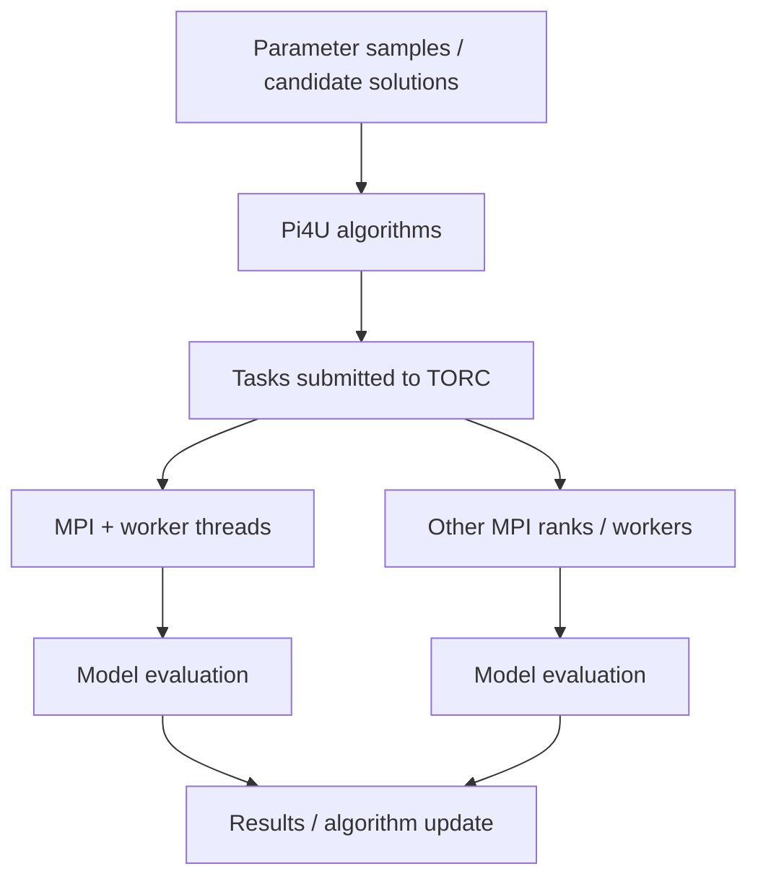

# Scientific applications and the TORC ecosystem

TORC has been used as an orchestration layer for complex computational workflows. This page documents **published examples of the TORC family and Torc-Lite's role as a runtime building block**; it does not imply the application codes are bundled with `torc_lite` or that old performance measurements describe today's machines.

## Pi4U: parallel Bayesian inference and optimization

[Pi4U](https://github.com/CEID-HPCLAB/pi4u) is a parallel framework for Bayesian inference, uncertainty quantification, reliability analysis and numerical optimization. It uses the TORC approach to express independent candidate evaluations, MCMC chains and nested physical-model evaluations as asynchronous tasks.

The original *Journal of Computational Physics* Pi4U paper (2015) discusses the use of TORC to implement task graphs for **TMCMC, stochastic-Newton TMCMC, subset simulation, CMA-ES and parallel numerical differentiation**. The **Euro-Par 2015** paper discusses TMCMC, ABC-SubSim and CMA-ES on multicore and hybrid CPU/GPU HPC systems.

The distinction is important: **Pi4U implements statistical/numerical algorithms; Torc-Lite implements the task execution infrastructure.**

## Published applications

| Example | Source context | Demonstrated pattern |
|---|---|---|
| Molecular dynamics of water | Pi4U JCP 2015; Euro-Par 2015 | Expensive GROMACS model evaluations; GPU-capable code invoked by tasks; balancing variable runtimes |
| Structural dynamics | Pi4U JCP 2015 | COMSOL/Matlab-derived external model evaluations dispatched by TORC |
| Granular flows | Pi4U JCP 2015 | Bayesian model calibration for discrete element simulations |
| Helium molecular dynamics | Euro-Par 2015 | ABC-SubSim with LAMMPS simulations and variable work |
| Fish-swimming optimization | Hadjidoukas 2022 application slides | NSGA-II candidate evaluations scheduled as irregular tasks; ML-assisted runtime estimates in historical research |

The **2022 CEID presentation** also includes CUBISM-MPCF, uDeviceX and data compression examples in the wider HPC research context. Those technologies are **not Torc-Lite runtime features** and should not be represented as such; where TORC appears, it orchestrates suitable application-level tasks.

## External-model coupling

The published papers discuss running simulation codes as external processes and, where warranted, persistent proxies to reduce process-spawning overhead. Those are **application integration strategies**. The Torc-Lite API is responsible for task distribution, data handling and synchronization; specialized launch/proxy logic belongs in a companion application such as Pi4U.

For practical usage see [task arguments](../concepts/arguments.md), [scheduling](../concepts/scheduling.md), and [Pi4U documentation](https://ceid-hpclab.github.io/pi4u/).
