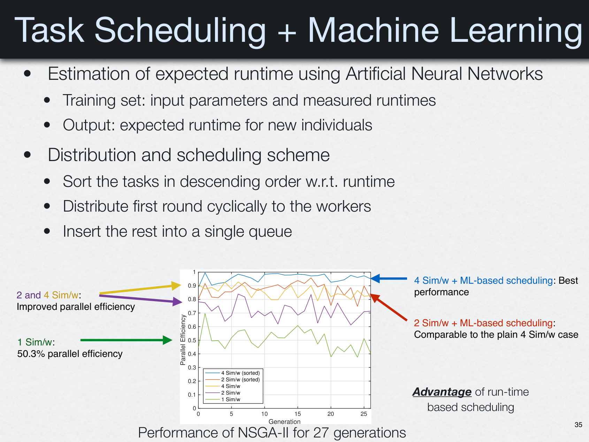

# Historical scheduling studies and machine learning

The uploaded CEID presentation **“Exploiting Task-Based Parallelism in Bayesian Uncertainty Quantification” (March 4, 2022)** documents experiments that combine TORC-style task execution with **predicted runtime information**. This is useful research background for evaluating scheduling strategies.

## Why prediction matters

In optimization and Bayesian inference, tasks often evaluate external simulation models. Their execution time can depend strongly on candidate parameters. Even with stealing enabled, scheduling long tasks early may reduce the tail of a parallel iteration.

The slides describe a workflow with:

1. A dataset of simulation input parameters and previously measured durations.
2. An artificial neural network that predicts the time needed for a new evaluation.
3. Descending-runtime ordering of tasks.
4. Cyclic distribution of an initial round of tasks, with remaining work queued for execution.
5. Comparison of resulting parallel efficiency with baseline task scheduling.

These are the **methods described in the historical experiment**, not promises that Torc-Lite contains a built-in neural-network scheduler.

*Hadjidoukas, CEID presentation (2022), slide 35: task runtime prediction and scheduling experiment in parallel NSGA-II.*

## Research opportunities

The current Torc-Lite runtime is a useful execution substrate for studying different scheduling policies at the application level:

- Round-robin initial assignment without runtime prediction.
- Coarse-grain tasks plus work stealing.
- Longest-predicted-processing-time-first ordering.
- Learning from completed task durations and updating predictions over iterations.

To obtain scientifically comparable results, measure wall-clock time, worker idle time, prediction error and overhead. Keep a clear distinction between **workload ordering in the application** and **the runtime's local/remote task queues and stealing policy**.

## Current implementation status

The public `include/torc.h` contains task submission and stealing controls but **does not expose a general ML-runtime-prediction or model-training API**. Integrating this historical research into a generalized predictive scheduling component would be new development, not a documentation-only feature.

Related pages: [Scheduling](../concepts/scheduling.md), [Performance](../concepts/performance.md), [Applications](applications.md).
